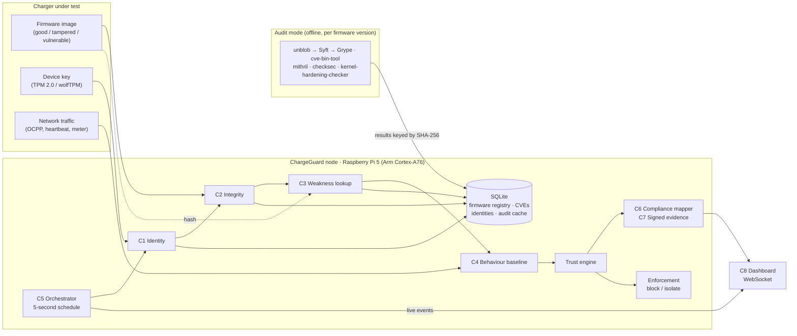

# ChargeGuard

**Plug in an EV charger. Get a green, amber or red trust verdict in seconds, backed by independent security checks and a signed, compliance-mapped evidence report. Everything runs on the edge node; nothing goes to the cloud.**


-A22846?logo=raspberrypi&logoColor=white)


## What this repository contains

ChargeGuard is an on-device security verifier for EV chargers, built for the Arm edge-AI challenge on on-device cybersecurity. A ChargeGuard node sits between a charger and the site network. When a charger is plugged in, the node checks:

- who the charger is
- whether its firmware is authentic
- whether that firmware has known vulnerabilities
- whether the charger is behaving normally

It then fuses those results into one verdict with a plain-English reason, and can isolate a charger that turns hostile mid-session.

This README describes what is in the repository today. Planned work is listed under [Roadmap](#roadmap). Each component's status is stated next to it. Every performance figure links to the committed measurement file that produced it.

The repository has three layers:

| Layer | What it is | Status |
|---|---|---|
| **Verification app** | Orchestrator, five checks, trust engine, compliance mapper, signed evidence report, live dashboard, charger simulator and attack modes | Runs end to end today (`python main.py`) |
| **Security integration layer** | [`attestation/`](attestation/README.md) for TPM 2.0 identity, and [`integrations/`](integrations/README.md) adapters for firmware integrity, firmware audit, behaviour baseline, evidence bundles and the attack lab | Implemented and unit-tested; not yet wired into the dashboard path |
| **Vendored toolchain** | 25 open-source security tools in [`vendor/`](vendor/README.md), grouped by capability, with license notices | Source snapshots; built per tool as needed |

## Contents

- [The problem](#the-problem)
- [Alignment with the challenge](#alignment-with-the-challenge)
- [How it works](#how-it-works)
- [Architecture](#architecture)
- [Demo scenarios](#demo-scenarios)
- [Arm architecture and tools](#arm-architecture-and-tools)
- [Performance and optimization](#performance-and-optimization)
- [Evidence and compliance](#evidence-and-compliance)
- [Quick start](#quick-start)
- [API](#api)
- [Configuration](#configuration)
- [Repository layout](#repository-layout)
- [Novelty](#novelty)
- [Roadmap](#roadmap)
- [Responsible use](#responsible-use)
- [License](#license)

## The problem

Public and depot EV chargers are networked embedded computers. A typical charger has:

- a microcontroller or embedded-Linux controller
- a firmware update channel
- a backend connection (usually OCPP over WebSocket)
- often local service ports

They are installed in places operators do not physically watch, maintained by third parties, and rarely re-checked after commissioning.

The threats that matter for a charger are concrete:

| Threat | What it looks like | What it costs |
|---|---|---|
| Rogue or cloned charger | A device that claims a legitimate identity | Fraudulent sessions, a foothold on the site network |
| Tampered firmware | Modified image after the vendor signed it | Arbitrary behaviour on high-power equipment |
| Authentic but vulnerable firmware | Correctly signed, but shipping libraries with known CVEs | A remotely exploitable device that passes signature checks |
| Live compromise | A healthy charger that starts scanning, beaconing or exfiltrating | Lateral movement into the operator's or the vehicle's network |

Existing tooling answers these questions separately. Firmware scanners run offline in a lab, attestation runs in data centres, and network monitors know nothing about firmware provenance. None of them gives the person plugging in a charger one answer they can act on.

The automotive regulations ChargeGuard maps to (UNECE R155 for cybersecurity, R156 for software updates) require exactly this kind of evidence across the supply chain.

**ChargeGuard's answer:** one inline Arm edge node that runs every check locally, keeps the slow analysis out of the plug-in path, and produces a single verdict plus a signed record of why.

## Alignment with the challenge

The challenge asks for an on-device AI security system that runs entirely on Arm edge hardware without cloud dependency. It should:

- monitor network traffic for intrusions
- explain threats in plain language
- recommend remediation

ChargeGuard applies that brief to one high-value device class. It fits two of the listed application areas directly: **IoT device behaviour monitoring** and **offline threat intelligence for air-gapped systems**.

| Challenge requirement | ChargeGuard component | Status today |
|---|---|---|
| Run entirely on Arm edge hardware, no cloud | Python services on a Raspberry Pi 5 class node; all lookups against local SQLite; offline signing and verification | Verification path runs locally. The dashboard page loads three.js and anime.js from a CDN; bundling them locally is on the [roadmap](#roadmap) |
| Monitor and classify network traffic for anomalies and intrusions | C4 behaviour monitor: per-charger baseline of peers, ports, message rates and protocol phases; detects port scans, C2 beacons, DNS exfiltration and floods ([`integrations/behavior`](integrations/behavior/baseline.py)) | Rule-based detector implemented and tested against all simulator attack modes. A learned traffic classifier is planned |
| IoT device behaviour monitoring | Same baseline, plus packet-capture inputs (iotaudit, tshark MQTT) | Implemented as adapters |
| Explain threats to non-expert users in plain language | Every verdict carries a one-sentence reason (for example *"charger runs authentic firmware but contains 3 known CVE(s) (max CVSS 9.8). Firmware upgrade recommended"*) | Template-based today. A Llama advisor is planned (below) |
| Recommend remediation actions | Verdict reasons include the action. The behaviour monitor outputs block, isolate or rate-limit and renders a wolfSentry firewall policy | Implemented |
| Offline threat intelligence | Firmware is audited once (SBOM, CVEs, secrets, hardening) and the result is cached by firmware hash for offline lookup | Implemented in the integration layer |
| **Required: Llama for advisory or reasoning, deployed with ExecuTorch** | On-device advisor that turns the verdict and findings into an explanation and remediation steps | **Planned, not in the repository yet**. Design in [Arm architecture and tools](#arm-architecture-and-tools) |
| Phishing URL and scam-message detection | Not part of the charger threat model. A charger console URL / QR-code checker for drivers is a candidate extension | Not implemented |

## How it works

### Audit once, verify fast

A deep firmware scan takes minutes to hours: unpacking, building the software inventory (SBOM), CVE matching and secret search. That cannot fit in a plug-in window. ChargeGuard therefore splits the work:

- **Audit mode (offline, once per firmware version).** The full scan runs ahead of time and stores its result keyed by the firmware's SHA-256 ([`integrations/vulnerability/pipeline.py`](integrations/vulnerability/pipeline.py)).
- **Verify mode (at plug-in).** The node measures the charger's firmware and does a single lookup by hash. The weakness check becomes a database read instead of a scan.

### The verification timeline

The design budget is 5 seconds, split into fixed windows ([`config.py`](config.py)):

| Window | Check | Question | How it is answered |
|---|---|---|---|
| 0.0 – 1.0 s | **C1 Identity** | Is this really that charger? | Challenge-response: the node sends a nonce, the charger signs it with its device key, and the node verifies the signature against the enrolled key. The TPM 2.0 quote path (PCRs + attestation key) is in [`attestation/`](attestation/README.md) |
| 1.0 – 2.0 s | **C2 Integrity** | Is its software untampered? | Firmware hash is looked up in the signed registry, then the vendor signature is verified |
| 2.0 – 3.0 s | **C3 Weaknesses** | Does it contain known weaknesses? | Lookup of the firmware hash in the pre-audit CVE database |
| 3.0 – 4.5 s | **C4 Behaviour** | Is it acting normally right now? | Live traffic sample compared with the charger's baseline |
| 4.5 – 5.0 s | **C5 Verdict** | Should we trust it? | Trust engine fuses the four results and the report is signed |

### Trust engine rules

The trust engine is [`orchestrator/trust_engine.py`](orchestrator/trust_engine.py). The rules are applied in order:

| Verdict | Condition | Score |
|---|---|---|
| **Red** | Identity fails | 0 |
| **Red** | Firmware integrity fails | 10 |
| **Red** | Behaviour is suspicious (the session is isolated) | 15 |
| **Amber** | Identity, integrity and behaviour pass, but known CVEs exist | 60 |
| **Green** | Every check passes | 100 |

## Architecture



**Components**

| ID | Component | Location |
|---|---|---|
| C1 | Identity and attestation | [`checks/identity`](checks/identity/identity_check.py), [`attestation/`](attestation/README.md) (TPM 2.0: software TPM, tpm2-tss, Keylime verifier, IBM TPM emulator) |
| C2 | Firmware integrity and secure update | [`checks/integrity`](checks/integrity/integrity_check.py), [`integrations/integrity`](integrations/integrity/__init__.py) (MCUboot, wolfBoot, RAUC, SWUpdate, Cosign, TUF) |
| C3 | Vulnerability and supply-chain audit | [`checks/weaknesses`](checks/weaknesses/weakness_check.py), [`integrations/vulnerability`](integrations/vulnerability/__init__.py) (unblob, Syft, Grype, cve-bin-tool, mithril, checksec, kernel-hardening-checker, EMBA, FACT) |
| C4 | Live behaviour monitor | [`checks/behavior`](checks/behavior/behavior_check.py), [`integrations/behavior`](integrations/behavior/__init__.py) (baseline rules, iotaudit, tshark MQTT, wolfSentry policy) |
| C5 | Orchestrator and trust engine | [`orchestrator/`](orchestrator/orchestrator.py) |
| C6 | Compliance mapper | [`policy/compliance_map.yaml`](policy/compliance_map.yaml), [`policy/mapper.py`](policy/mapper.py) |
| C7 | Evidence bundle | [`evidence/`](evidence/report_generator.py) (signed SARIF-structured report), [`integrations/evidence`](integrations/evidence/bundle.py) (SARIF 2.1.0 + CycloneDX + SHA-256 manifest + Cosign) |
| C8 | Dashboard | [`dashboard/`](dashboard/main.py) (FastAPI + WebSocket, single-page UI with a 3D scene) |
| C9 | Attack and test harness | [`simulator/attacker.py`](simulator/attacker.py), [`integrations/attack_lab`](integrations/attack_lab/scenarios.py) (Renode, IoTGoat, Bruce, Facedancer) |
| C10 | Charger simulator | [`simulator/charger.py`](simulator/charger.py) |

## Demo scenarios

The simulator reproduces the four demo acts. The verdicts below come from the committed benchmark run ([`benchmarks/results/amd64-win32.json`](benchmarks/results/amd64-win32.json), `end_to_end`):

| Act | Simulator mode | What happens | Verdict |
|---|---|---|---|
| 1. Healthy | `healthy` | Genuine device, authentic firmware v2.1.0, no CVEs, normal traffic | **Green** |
| 2. Tampered firmware | `tampered` | Payload modified after signing; hash not in the registry | **Red** at the integrity step |
| 3. Signed but vulnerable | `vulnerable` | Authentic v1.8.3 image carrying CVE-2022-0778, CVE-2021-28831 and CVE-2022-37434 | **Amber**, with the CVE list and an upgrade recommendation |
| 4. Live compromise | `compromised` | Healthy device begins abnormal traffic | **Red** at the behaviour step; the session is isolated |

The dashboard's attack panel also composes attacks individually:

- **Identity:** legitimate, unknown or cloned
- **Firmware:** good, tampered or vulnerable
- **CVEs:** manual injection of chosen CVEs
- **Behaviour:** port scan, C2 beacon, DNS exfiltration or burst, with a configurable target and rate

**User flow: three clicks.**
1. **Verify:** the charger is connected and verification starts.
2. **Watch:** the checks tick off live while the status ring fills.
3. **Evidence:** open the reasoning and download the signed report.

## Arm architecture and tools

### Where Arm runs in the system (target deployment)

| Role | Hardware | Arm core | What runs there |
|---|---|---|---|
| ChargeGuard node | Raspberry Pi 5 | 4× Cortex-A76 (Armv8.2-A) | Orchestrator, checks, trust engine, dashboard server, audit cache; planned Llama advisor |
| Charger controller (MCU class) | Cortex-M microcontroller; emulated in Renode on the STM32F4 Discovery platform (Cortex-M4) | Cortex-M | Firmware verified by MCUboot or wolfBoot; device identity on an SPI/I2C TPM via wolfTPM; wolfSentry firewall |
| Charger controller (Linux class) | Arm Linux board (for example a second Raspberry Pi) | Cortex-A | A/B updates via RAUC or SWUpdate; Keylime agent for continuous attestation |

### Arm ecosystem components in the repository

- **MCUboot** ([`vendor/secure-boot/mcuboot`](vendor/secure-boot/mcuboot)). The bootloader used by Trusted Firmware-M and Zephyr on Cortex-M. `imgtool verify` checks charger images in [`integrations/integrity/bootloader.py`](integrations/integrity/bootloader.py).
- **Mbed TLS.** MCUboot's crypto backend, pinned at exact commits in [`vendor/submodules.lock`](vendor/submodules.lock).
- **Renode** ([`vendor/attack-lab/renode`](vendor/attack-lab/renode)). Boots Cortex-M charger firmware without hardware ([`integrations/attack_lab/renode.py`](integrations/attack_lab/renode.py)), so tampered-image tests run in CI.
- **wolfBoot, wolfTPM, wolfSentry.** Bootloader, TPM and firewall libraries for Cortex-M targets.

### Planned on-device AI: two separate pipelines

| | Advisor (required technology) | Traffic classifier (optional accelerator) |
|---|---|---|
| Model | Llama 3.2 1B Instruct | Compact tabular/sequence classifier trained on CICIDS2017 / UNSW-NB15 flow features plus recorded charger baselines |
| Runtime | ExecuTorch, XNNPACK backend (KleidiAI micro-kernels for Arm) | HailoRT on the AI HAT+ NPU when fitted; otherwise ExecuTorch on the CPU |
| Compute unit | Cortex-A76 CPU | Hailo NPU, or the Cortex-A76 CPU |
| Input | Verdict, per-check findings, CVE list and behaviour anomalies (structured JSON) | Flow features from the behaviour monitor |
| Output | Plain-language explanation and ranked remediation steps, grounded only in the evidence it is given | Anomaly score feeding C4 alongside the rule baseline |
| Path in the 5-second budget | Outside it: runs after the verdict is signed, so a slow generation never delays the decision | Inside the C4 window |

The two pipelines are independent. Llama never runs on the Hailo NPU, and the classifier never depends on Llama.

**Profiling plan.** Arm Performance Studio (Streamline) on the Pi 5, to attribute advisor latency to prefill, decode and memory bandwidth, and to confirm the verification path stays within its window while the advisor runs.

## Performance and optimization

### Measured

All numbers below come from [`benchmarks/results/amd64-win32.json`](benchmarks/results/amd64-win32.json), produced by [`benchmarks/bench_hotpath.py`](benchmarks/bench_hotpath.py).

**Measurement setup**

| | |
|---|---|
| Host | Intel Core i9-14900HX, Windows 11, Python 3.12.10, cryptography 46.0.7 (development host, **not** the Arm target) |
| Component timings | 1,000 calls each after 20 warm-up calls, single thread |
| End-to-end timings | 5 runs per scenario |

**End to end, as the dashboard runs it**

| Scenario | Verdict | p50 wall time | max |
|---|---|---|---|
| healthy | green | 3.016 s | 3.047 s |
| tampered | red | 2.713 s | 2.721 s |
| vulnerable | amber | 3.005 s | 3.028 s |
| compromised | red | 3.019 s | 3.037 s |

The checks contain fixed `asyncio.sleep()` delays totalling 2.95 s. These stand in for TPM and network round-trips. The end-to-end figure is therefore the user-facing timeline, and it lands inside the 5-second budget with about 2 seconds of headroom.

**Compute on the hot path (no simulated delays)**

| Operation | p50 | p95 |
|---|---|---|
| C1 nonce sign + verify (Ed25519) | 0.086 ms | 0.089 ms |
| C1 identity registry lookup (SQLite) | 1.522 ms | 1.771 ms |
| C2 firmware registry lookup (SQLite) | 1.495 ms | 1.713 ms |
| C2 vendor signature verify (Ed25519) | 0.063 ms | 0.071 ms |
| C3 CVE lookup by firmware hash (SQLite) | 0.509 ms | 0.672 ms |
| C4 baseline, normal traffic | 0.020 ms | 0.022 ms |
| C4 baseline, C2-beacon traffic | 0.047 ms | 0.050 ms |
| C5 verdict fusion | 0.0003 ms | 0.0004 ms |
| C7 verdict signing (Ed25519, includes loading the key) | 0.164 ms | 0.186 ms |
| TPM quote, software TPM (ECDSA P-256) | 0.031 ms | 0.032 ms |
| TPM quote verification (signature, nonce, PCR digest) | 0.066 ms | 0.070 ms |

The real work in a verification adds up to about 4 ms; the cryptography is a small fraction of it.

**The largest cost is the database access pattern, not the security logic.** Each registry lookup opens a new SQLite connection, re-applies `PRAGMA journal_mode=WAL` and closes it. The same query on a connection that stays open takes **0.005 ms** (`reference_same_lookup_persistent_connection` in the results file), about 280× faster.

### Design choices for the edge

| Constraint | Decision |
|---|---|
| Latency | The heavy analysis (SBOM, CVE matching, secret search) is moved to audit mode; plug-in time does hash lookups only. The advisor runs after the verdict, never in its path |
| Compute and power | Plain CPU code with no GPU or always-on accelerator in the verification path. The node idles between plug-in events, and the audit pipeline runs once per firmware version, not per session |
| Memory | A small SQLite store and a YAML baseline per charger model. A 1B-parameter Llama with 4-bit weights is the planned advisor size, chosen to fit beside the services on a Pi 5 |
| Cost | A single Raspberry Pi 5 with a TPM module per site entrance, rather than a server; the optional AI HAT+ is used only if the traffic classifier needs it |
| Reliability | Each check has a 2-second timeout in the orchestrator, so a hung check yields a failed check, not a hung verdict |

### Next measurements

- Run `python benchmarks/bench_hotpath.py` on the Raspberry Pi 5 and commit `benchmarks/results/aarch64-linux.json`.
- Switch the registry lookups to a persistent connection and re-measure.
- Measure advisor tokens per second and time-to-first-token with ExecuTorch on the Cortex-A76.

## Evidence and compliance

Each verification produces a JSON evidence report in `evidence/reports/<session_id>.json`, containing:

- the verdict, score and reason
- the per-check results, structured as SARIF runs
- the compliance controls each check provides evidence for
- an Ed25519 signature over the payload ([`evidence/signer.py`](evidence/signer.py))

The report is available from the dashboard's evidence button and `GET /api/report/{session_id}`.

The compliance map ([`policy/compliance_map.yaml`](policy/compliance_map.yaml)) links the four checks to **17 controls**:

| Standard | Controls mapped |
|---|---|
| UNECE R155 (vehicle cybersecurity management) | 4 |
| UNECE R156 (software update management) | 1 |
| ETSI EN 303 645 (consumer IoT security) | 4 |
| ISA/IEC 62443-4-2 (industrial component security) | 4 |
| NIST SP 800-193 (platform firmware resiliency) | 4 |

The integration layer extends this to a standards-format bundle ([`integrations/evidence/bundle.py`](integrations/evidence/bundle.py)):

- `verdict.json`
- `findings.sarif` (SARIF 2.1.0)
- `sbom.cdx.json` (CycloneDX from Syft)
- `manifest.json`, which records the SHA-256 of every file, signed with Cosign

Changing any byte of any file fails `verify_bundle`.

## Quick start

Requires Python 3.10 or newer.

```bash
pip install -r requirements.txt
python main.py
```

On first run, `main.py`:

1. initialises the SQLite database
2. generates the three demo firmware images and the vendor and device keys
3. seeds the firmware registry, CVE database and identity registry
4. checks the compliance map
5. opens the dashboard at <http://localhost:8000>

Generated files (`db/*.db`, `firmware/images/`, `firmware/keys/`, `evidence/reports/`) stay local and are not committed.

**Tests**

```bash
python -m pytest tests
```
20 tests cover:

- the attestation layer
- the behaviour baseline against every simulator attack mode
- the wolfSentry policy output
- tool-output parsers and the per-firmware audit cache
- wolfBoot digest checks
- SARIF output and evidence-bundle tamper detection

**Benchmark**

```bash
python benchmarks/bench_hotpath.py
```
Writes `benchmarks/results/<machine>-<os>.json`.

**Security tools available on this machine**

```bash
python -m integrations
```
Lists each external tool, whether it was found, and how to build or install it. Several tools (EMBA, RAUC, SWUpdate, unblob's extractors) are Linux-only and run on the Pi or in WSL.

## API

| Method | Path | Description |
|---|---|---|
| GET | `/` | Dashboard |
| GET | `/api/scenarios` | Preset attack scenarios |
| POST | `/api/verify` | Start a verification with a preset `mode` or a granular attack configuration; returns `session_id` |
| WS | `/ws/{session_id}` | Live stream of `check_start`, `check_done` and `verdict` events |
| GET | `/api/report/{session_id}` | Signed evidence report (JSON) |
| GET | `/api/session/{session_id}` | Session status |

## Configuration

| Variable | Default | Purpose |
|---|---|---|
| `CHARGEGUARD_TPM_BACKEND` | `software` | Attestation backend: `software`, `tpm2-tss`, `wolftpm` |
| `CHARGEGUARD_TPM_TCTI` | `mssim:host=127.0.0.1,port=2321` | tpm2-tss transport; `device:/dev/tpmrm0` for a hardware TPM |
| `CHARGEGUARD_TPM_EMULATOR` | `vendor/tpm/ibmswtpm2/src/tpm_server` | IBM software TPM binary |
| `CHARGEGUARD_TPM_EMULATOR_PORT` | `2321` | Emulator command port |
| `CHARGEGUARD_KEYLIME_VERIFIER` | `https://127.0.0.1:8881` | Keylime verifier URL |
| `CHARGEGUARD_KEYLIME_API` | `2.3` | Keylime REST API version |
| `CHARGEGUARD_KEYLIME_CERT`, `_KEY`, `_CA` | unset | Mutual-TLS client certificate, key and CA for Keylime |
| `CHARGEGUARD_TOOL_<NAME>` | unset | Explicit path to an external tool, for example `CHARGEGUARD_TOOL_SYFT=/opt/syft` |

## Repository layout

```
main.py            Entry point: setup, then the dashboard server
config.py          Paths, the 5-second schedule, verdicts, simulator modes
checks/            C1–C4 checks used by the verification app
orchestrator/      C5 orchestrator and trust engine
policy/            C6 compliance map and mapper
evidence/          C7 report generator and Ed25519 signer
dashboard/         C8 FastAPI backend, WebSocket stream, web UI
simulator/         C9 attack modes and C10 charger simulator
firmware/          Demo firmware image and key generator
db/                SQLite registry: firmware, CVEs, identities, runs
attestation/       C1 TPM 2.0 attestation: backends, verifiers, emulator launcher
integrations/      C2–C4, C7, C9 adapters for the vendored security tools
benchmarks/        Hot-path benchmark and committed results
tests/             pytest suite
vendor/            Vendored open-source tools, grouped by capability
```

Each layer has its own documentation: [`attestation/README.md`](attestation/README.md), [`integrations/README.md`](integrations/README.md) and [`vendor/README.md`](vendor/README.md). The vendored tools are:

| Capability | Tools |
|---|---|
| TPM and attestation | tpm2-tss, wolfTPM, Keylime, IBM Software TPM |
| Secure boot | MCUboot, wolfBoot |
| Updates | RAUC, SWUpdate, python-tuf |
| Signing | Cosign |
| Firmware analysis | unblob, Syft, Grype, cve-bin-tool, mithril, checksec, kernel-hardening-checker, FACT, EMBA |
| Network | iotaudit, wolfSentry |
| Attack lab | IoTGoat, Bruce, Facedancer, Renode |

## Novelty

- **A plug-in-time trust verdict for chargers.** Attestation, firmware provenance, known-vulnerability status and live behaviour are fused into one green / amber / red decision at the moment of connection, instead of four separate tools run by four teams.
- **Audit once, verify fast.** Minutes of firmware analysis become a single hash lookup at plug-in (0.5 ms measured), which is what makes a seconds-scale verdict possible on a single-board computer.
- **"Authentic but vulnerable" is a first-class outcome.** Signature checks alone pass a correctly signed image with exploitable libraries; ChargeGuard reports it as amber with the CVEs and the fix.
- **Verification that keeps watching.** The behaviour baseline encodes what a charger should do (peers, ports, rates and protocol phase order), so a charger that passed at plug-in can still be isolated mid-session, with the enforcement rendered as an embedded firewall policy.
- **Evidence as an output, not an afterthought.** Every verdict is signed and mapped to automotive and IoT standards controls, ready for an auditor.

## Roadmap

**Done**

- End-to-end verification app: five checks, trust engine, live dashboard, four demo acts plus composable attacks
- Signed, compliance-mapped evidence report (17 controls, five standards)
- TPM 2.0 attestation layer with software, tpm2-tss and Keylime paths, and an IBM TPM emulator launcher
- Integration adapters for firmware integrity, firmware audit with a per-hash cache, behaviour baseline with block and isolate, SARIF + CycloneDX evidence bundles and a Renode attack lab
- Hot-path benchmark with committed results

**Next**

- Llama 3.2 1B Instruct advisor exported with ExecuTorch (XNNPACK) running on the Pi 5 CPU, grounded in the signed evidence
- Learned traffic classifier (CICIDS2017 / UNSW-NB15 plus charger captures) beside the rule baseline; HailoRT on the AI HAT+ where fitted
- Wire `attestation/` and `integrations/` into the four checks so the dashboard uses real TPM quotes, firmware audits and packet captures
- Persistent SQLite connections on the hot path
- Bundle the dashboard's JavaScript libraries for fully air-gapped operation
- Run the benchmark on the Raspberry Pi 5, and profile with Arm Performance Studio
- Hardware demo: a Pi 5 node with an SPI TPM, and a second board or Renode-emulated Cortex-M as the charger

## Responsible use

The attack harness exists to exercise ChargeGuard in a lab:

- tampered images
- emulated controllers
- wireless and USB test firmware for separate hardware

Use it only on equipment and networks you own or are authorised to test. ChargeGuard never invokes the wireless or USB tools automatically.

## License

ChargeGuard's own source code has no open-source license file yet.

Vendored components remain under their own licenses, which are kept in each component's folder. [`THIRD_PARTY_NOTICES.md`](THIRD_PARTY_NOTICES.md) lists every component, its snapshot and its obligations.
